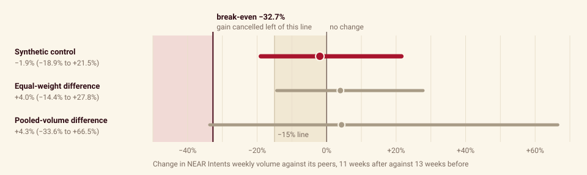
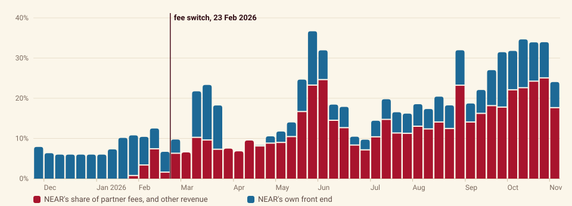
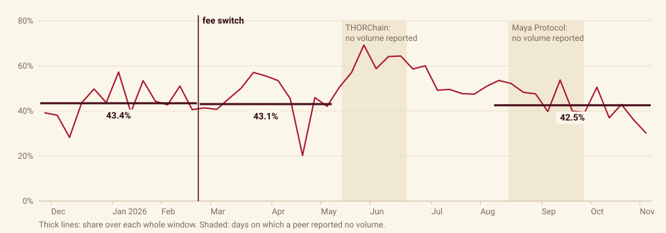

# Capture without churn

**Question.** In February 2026 NEAR started taking a share of the fees that partner apps charge on NEAR Intents swaps. Did the swaps leave?

**Entry for** the NEAR Hackathon, Investment Thesis track. The thesis, with evidence for and against, is in [THESIS.md](THESIS.md). The dashboard is live at <https://aloysjehwin.github.io/near-capture-without-churn/> (same file as [docs/index.html](docs/index.html)).

<!-- results:start -->
**Verdict: SUPPORTED IN PART.** NEAR's take per $100 swapped rose from 1.42 to 2.11 cents. Volume would have had to fall 32.7% to cancel that. Against 7 peers it changed by -1.9% (90% interval -18.9% to +21.5%). The higher cut paid for itself. A loss of up to 18.9% cannot be ruled out.

| What | Value |
| --- | --- |
| NEAR's take per $100 swapped, 13 weeks before the switch | 1.42 cents |
| NEAR's take per $100 swapped, 11 weeks after | 2.11 cents (1.49x) |
| Volume loss that would cancel the gain (break-even) | 32.7% |
| Volume change against 7 peers | -1.9% (90% interval -18.9% to +21.5%) |
| Largest loss the data cannot rule out | 18.9% |
| Fee users paid per $100 swapped, before and after | 17.7 and 17.8 cents |
| NEAR Intents' share of the peer basket: before, after, latest | 43.4%, 43.1%, 42.5% |
| Share of fees NEAR kept in the latest 13 weeks | 27.10% (3.38x the level before) |
| Clean specifications run | 693 (median +2.3%, range -17.3% to +34.1%) |
| The 10 largest partner apps before the switch: volume per day after, and latest (sample of NEAR's swap records) | 0.94x, 1.29x |
| Of those 10, below 10% of their earlier volume after the switch | 2 (infinex.near and rhea) |







Data through 2026-11-12. Snapshot fetched 2026-11-13T18:09:28Z. All figures are written by `python3 -m cwc rebuild`.
<!-- results:end -->

## Check it yourself

Needs Python 3.10 or later. Nothing to install. No network. No API key.

| Do this | You should see |
| --- | --- |
| `python3 -m cwc verify` | Each output file listed as `identical`, then `All 13 committed files are byte-identical to a fresh rebuild from the snapshot.` and the verdict. Exit code 0. Takes about 10 seconds. |
| `python3 -m unittest discover -s tests` | `OK` at the end. |
| `python3 -m cwc rebuild` | Each output file listed as `unchanged`, then the verdict and the headline numbers. |
| Edit `config/analysis.json` (for example set `"pre_weeks": 17`), then `python3 -m cwc rebuild` | Files listed as `written`, new numbers everywhere. `git diff` shows what moved. |
| Change one byte in any file under `data/raw/`, then `python3 -m cwc verify` | `Stopped: hash mismatch for ...`. Exit code 2. The analysis refuses to run on altered data. |

`make verify`, `make test` and `make rebuild` do the same if you have `make`.

## What is in the box

| Path | What it is |
| --- | --- |
| `THESIS.md` | The thesis: verdict, evidence for, evidence against, what would change it. Generated. |
| `out/findings.json` | Every number, the verdict, the data fingerprints. Generated. Everything else is formatted from this file. |
| `docs/index.html`, `docs/charts/` | Dashboard and its nine charts. Generated. No external files. |
| `data/raw/` | DefiLlama's responses, stored unchanged, with `MANIFEST.json` (address, fetch time, SHA-256). |
| `data/explorer/` | A sample of NEAR's own swap records, kept as totals per partner app, with `MANIFEST.json` (SHA-256). No user addresses, no single swaps. |
| `config/series.json` | The data sources and which service plays which role. |
| `config/analysis.json` | Every analysis choice and threshold. |
| `cwc/` | The code. Standard library only. `pipeline.py` computes, `verdict.py` decides, `report.py` and `site.py` format. |
| `thesis/THESIS.template.md` | The thesis text with placeholders. It contains no results. |
| `scripts/refresh.py` | Downloads a new DefiLlama snapshot. Needs the network, no key. |
| `scripts/explorer_sample.py`, `scripts/explorer_manifest.py` | Take a new partner sample from NEAR's Explorer API (needs the network and a partner key) and record its hash. Not needed to check anything here. |
| `tests/` | Unit tests, including one that rebuilds with the network blocked. |
| `docs/designs/` | The design document and the review notes on it. |

## Method in ten lines

1. Take DefiLlama's daily volume, fees and revenue for NEAR Intents, and daily volume for seven comparable services.
2. The event is 2026-02-23, when NEAR's buyback programme starts in DefiLlama's data; NEAR's post of the next day says the fee switch is live.
3. Compare the 13 weeks before with the 11 weeks after. Eleven is every whole week before THORChain's trading halt in May 2026.
4. Measure NEAR's take: revenue per dollar swapped. Move lumpy front-end transfers back onto the days they were earned.
5. Break-even: if the take goes from t0 to t1, revenue is unchanged when volume changes by t0 / t1 - 1.
6. Build a weighted basket of the peers that tracked NEAR Intents before the event (synthetic control with an intercept).
7. Put a 90% permutation interval on how far NEAR Intents moved from the basket afterwards.
8. Check the method: run it on each peer, backdate it, try two simpler estimators.
9. Rerun under every other event date, window and peer set in the configuration (the specification curve).
10. Apply fixed rules to get the verdict. The rules are in `cwc/verdict.py`.

Beside the rules: a sample of NEAR's own swap records shows what each of the largest partner apps did. THESIS.md section 5 has it.

## What this does not do

* It does not show why a partner app sent less. The partner sample shows which ones did, not the reason, and it covers only the part of NEAR Intents that runs through the 1Click service.
* It does not prove cause. Other things changed in the same week.
* It does not use on-chain data, daily data, or volume for Relay, Across and deBridge. THESIS.md section 10 says why.
* It does not forecast the price of NEAR.

## Refreshing the data

```
python3 scripts/refresh.py      # needs network; rewrites data/raw/ and MANIFEST.json
python3 -m cwc rebuild          # offline
```

The verdict can change after a refresh. `git diff` shows which numbers moved.

## Disclosures

* The code and text were written with Claude (Anthropic) under the author's direction.
* No third-party libraries. Python standard library only.
* Data from DefiLlama's free API, and a sample from NEAR's Explorer API taken with the author's partner key. The key is not in this repository. External facts are cited in THESIS.md section 12.
* The decision thresholds were set after an exploratory look at the same data. THESIS.md section 4.9 says what that means.

## Licence

MIT. See [LICENSE](LICENSE).
