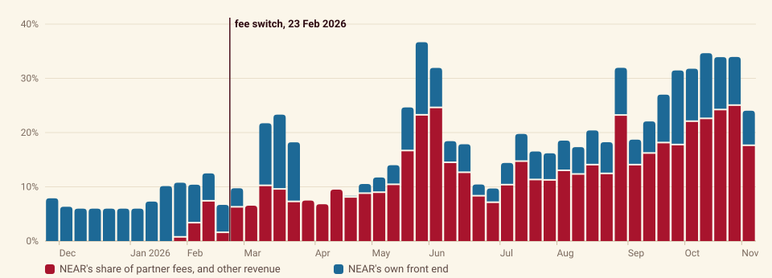
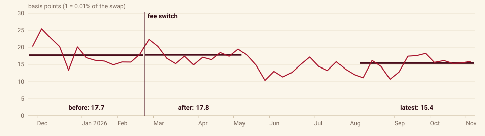
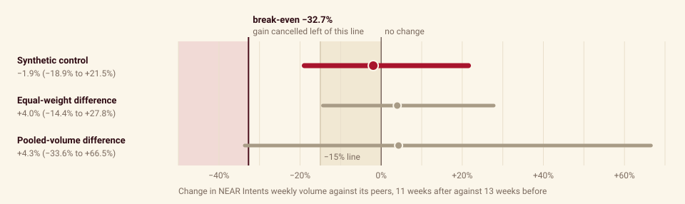
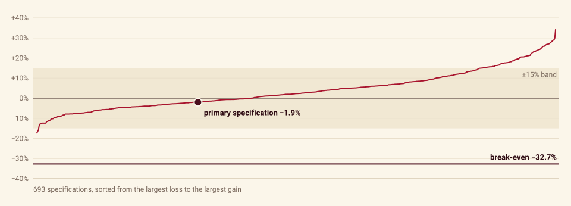
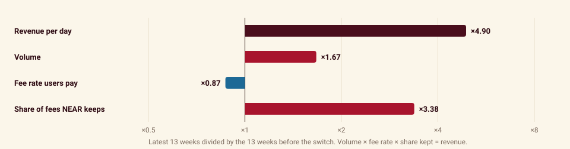
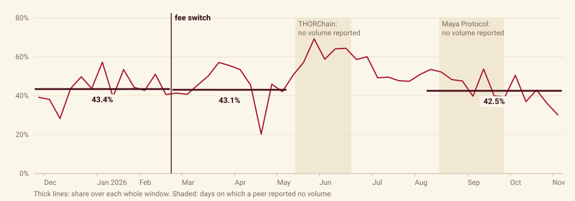

# Capture without churn

**Thesis.** NEAR can take a larger share of the fees on NEAR Intents swaps without losing the swaps. If that is true, NEAR has pricing power over cross-chain swap flow, and the revenue that pays for NEAR buybacks can grow faster than volume.

**Verdict: SUPPORTED IN PART.** NEAR's take per $100 swapped rose from 1.42 to 2.11 cents. Volume would have had to fall 32.7% to cancel that. Against 7 peers it changed by -1.9% (90% interval -18.9% to +21.5%). The higher cut paid for itself. A loss of up to 18.9% cannot be ruled out.

Every figure in this file is written by `python3 -m cwc rebuild` from a committed data snapshot. Data run through 2026-11-12. The snapshot was fetched 2026-11-13T18:09:28Z. Nothing here is typed by hand, and nothing is estimated from memory.

## 1. The question in plain words

NEAR Intents swaps one crypto asset for another across blockchains. Wallets and apps (called partners here) send their users' swaps to it and add a fee on top. The user pays that fee. Until early 2026 NEAR earned little from partners' swaps: in the 13 weeks before the change, its share of partner fees, together with smaller items, came to 1.02% of all fees paid, and 87% of NEAR's revenue from Intents came from its own app.

In late February 2026 NEAR turned on what it calls the fee switch: an automatic split of partner fees between the partner and NEAR. NEAR's documentation gives the default split as 50/50, with other terms possible by agreement. NEAR uses its part to buy NEAR tokens on the open market. This file dates the switch to 23 February 2026; section 7 says why.

A partner that has to hand over half of its fee has three choices:

1. Send its swaps somewhere else. Then NEAR Intents volume falls against its rivals.
2. Charge users more to make up the difference. Then the fee users pay per dollar swapped goes up.
3. Accept it. Then neither of those moves.

This file tests the first two with public data. In one sentence: in the 11 weeks after the fee switch NEAR's take per dollar swapped was 1.49x its level before, the fee rate users pay rose 0.4%, and NEAR Intents' share of the peer basket went from 43.4% to 43.1%. A volume loss of up to 18.9% cannot be ruled out; the loss that would cancel the gain is 32.7%.

## 2. The numbers

|  | 13 weeks before | 11 weeks after | latest 13 weeks |
| --- | --- | --- | --- |
| Dates | 2025-11-24 to 2026-02-22 | 2026-02-23 to 2026-05-10 | 2026-08-10 to 2026-11-08 |
| Swap volume per day | $79.0M | $64.5M | $132.0M |
| Fees users paid per $100 swapped (cents) | 17.7 | 17.8 | 15.4 |
| Share of fees NEAR kept | 8.03% | 11.89% | 27.10% |
| - from partner fees and other | 1.02% | 7.89% | 18.58% |
| - from its own front end | 7.01% | 4.01% | 8.53% |
| NEAR's take per $100 swapped (cents) | 1.42 | 2.11 | 4.17 |
| NEAR's revenue per day | $11.2K | $13.6K | $55.0K |
| NEAR Intents' share of the peer basket | 43.4% | 43.1% | 42.5% |

How to read it:

* "Share of fees NEAR kept" is NEAR's revenue divided by all fees users paid. DefiLlama splits that revenue into two labelled parts, and both are shown.
* "Take per $100 swapped" is revenue divided by volume. It equals the fee rate times the share NEAR kept. It is the number that matters for NEAR's revenue: revenue = volume x take.
* NEAR's own app sends its revenue to NEAR's wallet in transfers that were up to 46 days apart, and DefiLlama counts each transfer on the day it was made. This file moves each transfer back onto the days it was earned. Without that step the share NEAR kept reads 7.87% before and 12.93% after (1.64x). With it, 8.03% and 11.89% (1.48x). The smaller, corrected figures are used everywhere.

## 3. Evidence for the thesis

**3.1 The cut rose.** NEAR's take per $100 swapped went from 1.42 cents to 2.11 cents, 1.49x. The rise is in the part the fee switch created: NEAR's share of partner fees, together with smaller items, was 1.02% of all fees before and 7.89% after. That part is paid every day from 2026-01-31, so its timing is not in doubt. Across 21 choices of event date and window length, the main one included, the take after the switch was between 1.28x and 1.64x its level before.



**3.2 Did users pay more?** The fee users paid per $100 swapped was 17.7 cents before and 17.8 cents after. The fee rate rose 0.4%, so on average partners did not pass the cost on.



**3.3 Volume against rivals.** NEAR Intents volume fell 18.4% after the switch. The 7 comparison services together fell 17.2% over the same weeks. NEAR Intents' share of the combined volume was 43.4% before and 43.1% after.

The formal test builds a weighted basket of the 7 peers that tracked NEAR Intents before the switch (LI.FI 56%, Bungee 25%, Maya Protocol 11%, Chainflip 8%) and asks how far NEAR Intents moved away from it afterwards. The answer is -1.9%, with a 90% interval of -18.9% to +21.5%.

**3.4 The gain against the break-even loss.** With the take at 1.49x, revenue only falls if volume drops by more than 32.7%. That is the break-even loss. The interval ends at -18.9%, which is 13.8 points away from it. NEAR's revenue per day was 1.21 times its level before.



**3.5 The answer does not hang on one choice.** The same test was run for 21 combinations of event date and window length. The break-even loss was ruled out in 18 of them. Across 693 specifications that also vary the peer set and the estimator, the estimate has a median of +2.3% and runs from -17.3% to +34.1%. 0.4% of them show a loss of more than 15%. The lowest is 15.5 points above the break-even loss.



**3.6 The test does not find effects that are not there.** Each of the 7 peers was put through the same test as if it had had the fee switch. The interval excluded zero for 0 of them. NEAR Intents' fit before the switch ranks 1 of 8 (1 is the closest fit).

| Unit treated as if it had the switch | Estimate | 90% interval | Interval excludes zero |
| --- | --- | --- | --- |
| THORChain | -0.1% | -60.3% to +163.8% | no |
| Chainflip | -3.5% | -29.9% to +123.7% | no |
| Maya Protocol | +23.3% | -24.4% to +198.9% | no |
| LI.FI | +10.0% | -23.3% to +31.0% | no |
| SOCKET | +4.0% | -32.6% to +46.2% | no |
| Rango | -14.1% | -44.6% to +7.8% | no |
| Bungee | -3.1% | -24.8% to +47.7% | no |

**3.7 Since then.** In the latest 13 weeks NEAR kept 27.10% of fees, 3.38x the level before the switch. Volume is 1.67x and the peers' volume 1.73x. NEAR Intents' share of the basket is 42.5%, against 43.4% before. Revenue per day is 4.90x. Splitting that growth exactly into its three factors, 77% came from the higher cut, 32% from volume and -9% from the fee rate.





## 4. Evidence against the thesis

**4.1 A real loss cannot be ruled out.** The interval reaches -18.9%. The strict form of the claim, that a loss of more than 15% is ruled out, fails. The largest loss the data cannot rule out is 18.9%.

**4.2 The gap was drifting down when the test had to stop.** NEAR Intents ran +4.5% against its basket in the first 5 weeks after the switch and -7.0% in the last 6. In the last three weeks it was -11.2%. The test cannot be extended: Maya Protocol and THORChain report no volume from 2026-05-16, and their users had to go somewhere. THORChain's own report dates an exploit and a trading halt to 15 May 2026.

**4.3 The basket follows NEAR Intents only loosely.** Before the switch the weekly gap between the two had a typical size of 0.14 log points, about the same as the 15% line. When the weights are fitted on the first 8 weeks only and the "switch" is pretended to happen on 2026-01-19, the test reports +6.4% where the true answer is zero.

**4.4 The result depends on the estimator at the margin.** The two simpler estimators give +4.0% (-14.4% to +27.8%) and +4.3% (-33.6% to +66.5%). The second one sums the peers' volume, so the largest peer drives it. Its interval reaches past the break-even loss, and its backtest error is +18.7%.

| Estimator | Volume change | 90% interval | Fit error before (log points) | Backtest (should be 0) |
| --- | --- | --- | --- | --- |
| synthetic control | -1.9% | -18.9% to +21.5% | 0.14 | +6.4% |
| equal-weight difference | +4.0% | -14.4% to +27.8% | 0.22 | +7.9% |
| pooled-volume difference | +4.3% | -33.6% to +66.5% | 0.30 | +18.7% |

**4.5 Some window choices disagree.** Of the 21 combinations, the interval could not be determined in 2 and the break-even loss was not ruled out in 1 (event 2026-02-02, 17 weeks before, 11 after: lower end -25.9% against a break-even of -24.7%). In 1 the whole interval is below zero, which is a detected loss (event 2026-02-23, 9 weeks before, 11 after: -24.0% to -5.8%).

**4.6 How much the cut rose depends on the window.** The take ratio is 1.49x for the main windows and as low as 1.28x for others, which puts the break-even loss anywhere from 21.8% to 38.9%.

**4.7 Volume did fall.** In dollars, NEAR Intents volume fell 18.4% after the switch. The claim is only that rivals fell about as much.

**4.8 The later rise has no test of its own.** NEAR's share of fees went from 11.89% in the test window to 27.10% in the latest one. No dated change is documented for that, so there is no before and after to compare. Longer windows are not a substitute. A peer's outage sends its users elsewhere, so a window that includes one is biased. The 171 specifications of that kind have a median of +11.9%. They are shown but do not count.

**4.9 The rules were written after a first look at the data.** The thresholds are in `config/analysis.json`, and its hash is in `out/findings.json`, but they were chosen after an exploratory run on the same data. No out-of-sample test exists yet. The only one is the dated check in section 6.

## 5. What these data cannot show

* **Which partners stayed.** Total volume can hold up while individual partners leave and others arrive. That needs swap-level data from NEAR's Explorer API, which requires a partner key.
* **Cause.** Other things happened in the same week: NEAR announced new products together with the fee switch (press release of 25 February 2026). The test measures what happened to volume, not why.
* **Whether the money was new.** Before 2026-01-31 DefiLlama records almost no revenue from partner fees. If NEAR was owed such revenue earlier and only started moving it then, the rise in the cut is overstated.
* **One short stretch of front-end revenue.** Front-end transfers are recorded daily only from 2026-04-27. Before that there were 14 transfers, and the correction in section 2 assumes each one was earned evenly, in proportion to fees, since the one before.
* **A true market share.** The basket is 7 services with a free daily volume series. Bridge aggregators route through other services, possibly including NEAR Intents, so the basket is an index, not a market total.

## 6. What would change the verdict

The verdict is computed by fixed rules in `cwc/verdict.py`. It becomes NOT SUPPORTED if any of these happens on a rebuild:

1. NEAR's take fails to rise under any one of the window choices.
2. The interval for the volume change reaches the break-even loss.
3. The estimate is below -15% and more than 50% of the clean specifications are too.
4. In the latest 13 weeks NEAR keeps less than 20% of fees (it gave the cut back), or NEAR Intents' share of the basket is more than 10 points below its level before the switch, whichever peer is left out. Today this rule passes: the share moved by -0.9 points (-4.1 to +3.3 leaving one peer out).

**Dated check.** Rule 4 will be read again on the first snapshot whose data run through the day before 2027-02-15. Status today: not yet due.

Partner-level evidence would also change it. If the largest partners from before the switch stopped sending swaps while new ones filled the gap, "without churn" would be the wrong name for what happened.

## 7. Method

* **Data.** DefiLlama's free API, no key. Daily volume, fees and revenue for NEAR Intents, revenue by label, and daily volume for the peers. Every response is stored unchanged in `data/raw/` with its address, fetch time and SHA-256 in `data/raw/MANIFEST.json`. The rebuild stops if a file does not match.
* **Event.** 2026-02-23. NEAR's post of 24 February 2026 says the fee switch is live. DefiLlama dates NEAR's buyback programme from 2026-02-23, and its buyback series is first above zero on 2026-02-23. Revenue from partner fees first appears earlier, on 2026-01-31, so 2026-02-02 is used as a second event date in the robustness runs.
* **Windows.** Weeks run Monday to Sunday, UTC. 13 weeks before the event and 11 weeks after. 11 is not a choice: it is every whole week before the first peer outage (11 weeks are available).
* **Weekly volume.** A week counts only if at least five of its seven days have a value above zero. Its volume is the sum of those days scaled to seven.
* **Main estimator.** Synthetic control with an intercept on log weekly volume: weights on the peers that are not negative and sum to one, chosen to track NEAR Intents over the weeks before the event. The weights are found exactly by solving every subset of peers, not by an iterative search.
* **Interval.** The permutation method of Chernozhukov, Wuthrich and Zhu. For each candidate effect, take it out of the weeks after the event, refit on all weeks, and compare the mean of the last 11 residuals with the same mean under every cyclic shift. The interval is the set of candidates not rejected at the 90% level, widened by one grid step at each end.
* **Break-even.** Revenue is volume times take. If take goes from t0 to t1, revenue is unchanged when volume changes by t0 / t1 - 1.
* **Peers.** The three native cross-chain swap protocols that SwapKit lists beside NEAR Intents, and every bridge aggregator in DefiLlama's list of 42 that has at least $1 billion of volume in the past year, is not flagged as double-counted, and has weekly volume in each of the 26 weeks before the event. The rebuild stops if the peers in the configuration differ from what these rules select. Adding the excluded candidates back changes the main estimate to +4.7%.

| Service | Kind | Used as a peer | Reason if not |
| --- | --- | --- | --- |
| THORChain | swap protocol | yes |  |
| Chainflip | swap protocol | yes |  |
| Maya Protocol | swap protocol | yes |  |
| Jumper | bridge aggregator | no | flagged as double-counted by DefiLlama |
| LI.FI | bridge aggregator | yes |  |
| Silentswap | bridge aggregator | no | no weekly volume in the week of 2025-08-25 |
| SOCKET | bridge aggregator | yes |  |
| Bitget Wallet X | bridge aggregator | no | no weekly volume in the week of 2025-08-25 |
| Rango | bridge aggregator | yes |  |
| OpenSea | bridge aggregator | no | flagged as double-counted by DefiLlama |
| 0x | bridge aggregator | no | no weekly volume in the week of 2025-08-25 |
| Bungee | bridge aggregator | yes |  |

## 8. Reproduce

```
python3 -m cwc verify      # rebuilds in memory and compares with the committed files
python3 -m cwc rebuild     # rewrites out/findings.json, THESIS.md, the README block and docs/
python3 -m unittest discover -s tests
```

Python 3.10 or later. No packages to install, no network, no key. Snapshot fingerprint 1517238020c83d4c, configuration fingerprint b8745fa66e1a45a5.

## 9. Not computed

* On-chain volume from NEAR's public BigQuery tables. The question is about volume, fees and revenue, which DefiLlama already publishes.
* Volume for Relay, Across and deBridge. DefiLlama's bridge-volume data answered "payment required" when this snapshot was taken, so they are not peers.
* A test on daily data. Weekly sums remove the day-of-week pattern and single-day reporting gaps. The cost is a coarser test: the p-value moves in steps of one over the number of weeks.
* Any price forecast for the NEAR token.

## 10. Disclosures

* The code and text in this repository were written with Claude (Anthropic) under the author's direction. The design was reviewed by separate AI reviewers and revised; the design and the review notes are in `docs/designs/`.
* No third-party code. Python standard library only.
* Data: DefiLlama. External facts: the sources below.

## 11. Sources

* NEAR, "Evolving NEAR Tokenomics", 24 February 2026: <https://near.org/blog/evolving-near-tokenomics>
* NEAR Intents documentation, fees: <https://docs.near-intents.org/resources/fees>
* DefiLlama, NEAR Intents (methodology notes are stored in the raw files): <https://defillama.com/protocol/near-intents>
* NEAR, press release "NEAR Unveils Confidential Cross-Chain Infrastructure for the Agentic Economy", 25 February 2026: <https://tools.prnewswire.com/en-us/live/20813/release/20260225EN95768>
* THORChain, exploit report for 15 May 2026: <https://blog.thorchain.org/thorchain-exploit-report-1>
* SwapKit, NEAR Intents compared with THORChain, Maya Protocol and Chainflip: <https://swapkit.dev/?p=2374>
* Abadie, Diamond, Hainmueller (2010), "Synthetic Control Methods for Comparative Case Studies", Journal of the American Statistical Association.
* Doudchenko, Imbens (2016), "Balancing, Regression, Difference-in-Differences and Synthetic Control Methods": <https://arxiv.org/abs/1610.07748>
* Chernozhukov, Wuthrich, Zhu (2021), "An Exact and Robust Conformal Inference Method for Counterfactual and Synthetic Controls": <https://arxiv.org/abs/1712.09089>
* Lakens (2017), "Equivalence Tests: A Practical Primer", Social Psychological and Personality Science.
* Simonsohn, Simmons, Nelson (2020), "Specification curve analysis", Nature Human Behaviour.
